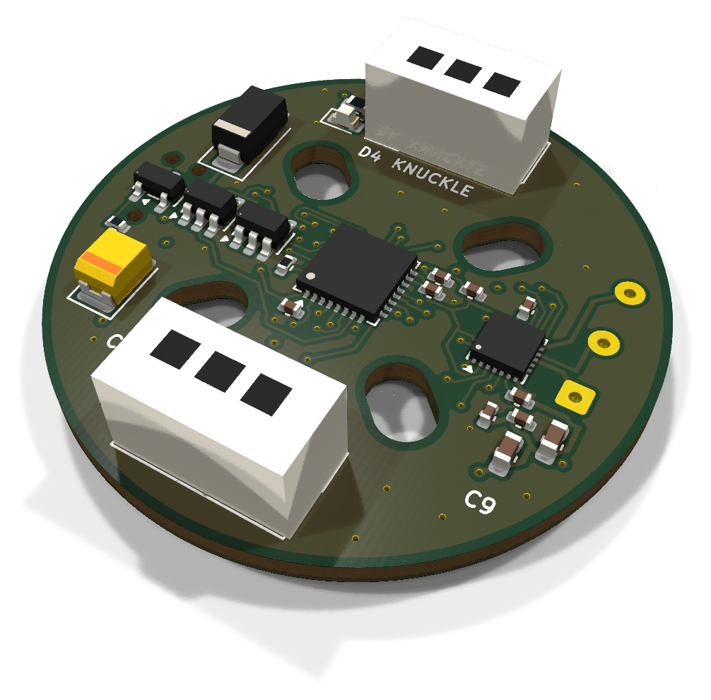
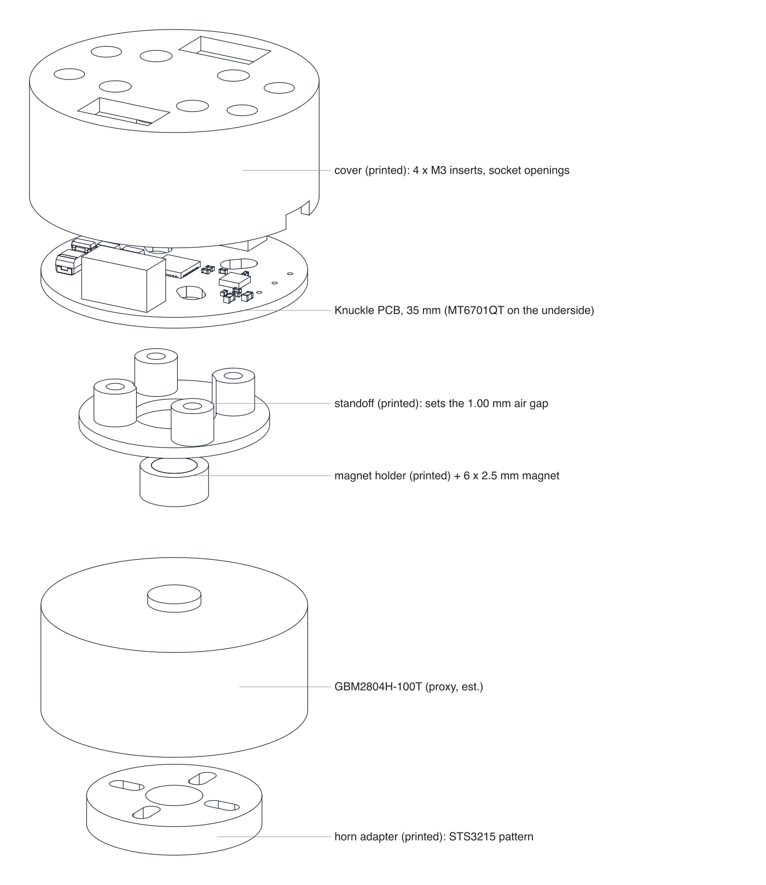
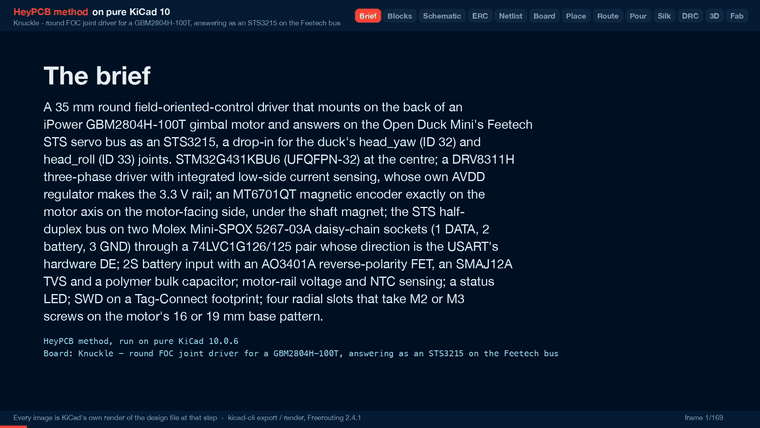

# Knuckle

A 35 mm round FOC driver that bolts to a GBM2804 gimbal motor and answers on the Open Duck Mini's servo bus as an STS3215.

Part of [HeyPCB's open robot boards](https://github.com/HeyPCB). Designed end to end with the HeyPCB method on
KiCad 10 (headless pipeline, Freerouting 2.4.1); every number below is measured on the files in this repository.
Mentions of `./run.sh`, `docs/rules/`, `blocks/` or `parts/` refer to the heypcb-kicad SDK that produced them.

<p align="center"></p>
<p align="center"></p>

| Layers | Outline | Parts | Nets | Connections routed | Vias | ERC errors | DRC errors / unconnected / parity |
|---|---|---|---|---|---|---|---|
| 6 | 35 mm round | 45 | 34 | 121 -> 0 open | 67 | 0 | 0 / 0 / 0 |

**Not fabricated, assembled or powered.**

| | |
|---|---|
| KiCad project | [`kicad/`](kicad/) |
| Gerbers (unzipped and zipped), BOM, CPL, STEP, schematic PDF | [`fab/`](fab/) |
| Printed parts (STEP/STL), CadQuery source, fit report | [`cad/`](cad/) |
| Renders | [top](media/top.png), [bottom](media/bottom.png) |
| Design process, every step as KiCad rendered it | [`media/design-process.mp4`](media/design-process.mp4) |

<p align="center"></p>

Knuckle is a 35 mm round field-oriented-control (FOC) driver that mounts on the back of an iPower
GBM2804H-100T gimbal motor and answers on the Open Duck Mini's Feetech STS servo bus as an STS3215
(model 777). It is meant as a drop-in for the duck's `head_yaw` (ID 32) and `head_roll` (ID 33)
joints. It was designed with the HeyPCB method on KiCad 10 (the headless heypcb-kicad pipeline,
KiCad 10.0.6, routed by Freerouting 2.4.1) from the brief in `board.json`, following the research
spec in `robots/research/actuator/spec.md`.

**It has not been fabricated, assembled or powered, and its firmware is not written.** The STS3215
emulation below is what that firmware must do; none of it exists yet. Every gate number below is
read from the final run's `report.json`. What this README says about copper, pours, pads and
silkscreen was read from `kicad/knuckle.kicad_pcb` with KiCad 10.0.6's pcbnew, and every
mechanical number was measured on the solids by `cad/parts.py` (`cad/fit.json`).
Numbers marked (est.) are estimates or come from the spec; they are not measurements.

- **MCU:** STM32G431KBU6 (UFQFPN-32, 5 x 5 mm, Cortex-M4F at 170 MHz) on its internal HSI16 clock, at the centre of the top face. SWD on a Tag-Connect TC2030-NL footprint on the bottom (nothing to fit).
- **Driver:** TI DRV8311H, a 3-20 V three-phase bridge (5 A peak, 210 mOhm high + low side) with three integrated low-side current-sense amplifiers. 3x PWM mode: TIM1 drives INHA/B/C, and one enable line drives all three INLx.
- **3.3 V rail:** the DRV8311's own AVDD regulator. There is no buck (see *Decisions*).
- **Encoder:** MagnTek MT6701QT (QFN-16, 14-bit, SSI) exactly on the motor axis on the motor-facing (bottom) face, under the shaft magnet, with its 100 nF. Nothing else is on the bottom face inside an 11 x 11 mm square around the axis.
- **Bus:** two Molex Mini-SPOX 5267-03A vertical sockets (pin 1 DATA, 2 battery, 3 GND) wired in parallel for daisy-chaining, opposite each other on the vertical axis. An SN74LVC1G126 drives DATA from USART2 TX while the USART's hardware DE is high; an SN74LVC1G125 passes DATA to RX while DE is low. DATA has 100 R in series, a 10k pull-up and a 5 V ESD diode.
- **Power in:** the 2S battery from the bus (6.0-8.4 V) through an AO3401A reverse-polarity P-FET, an SMAJ12A TVS and a 22 uF / 25 V polymer tantalum bulk capacitor.
- **Sensing:** motor-rail voltage (100k / 22k) and a 10k NTC beside the driver.
- **Other:** a red status LED; the motor's three phase leads solder into plated holes at the right rim; four radial screw slots for the motor's base pattern.
- **Board:** a 35.0 mm circle (the motor's own diameter), 6 layers, 1.6 mm. F.Cu, In1 a GND plane, In2-In4 and B.Cu routed; after routing F.Cu and B.Cu are poured GND, In2 and In4 VBAT, In3 VM.

## Scope: head joints only

The spec's answer, which this board follows: a 2804-class gimbal motor on a 2S pack cannot replace an
STS3215 in a duck leg, direct or geared. The numbers are the spec's (sections 0 and 2; model outputs
and MuJoCo static torques, not bench measurements):

| | Stall torque | Speed | Note |
|---|---|---|---|
| STS3215, 7.4 V (datasheet) | 1.91 N·m | 5.45 rad/s | what the duck's legs use |
| GBM2804H-100T, direct drive, 7.4 V | 0.047 N·m (est.) | 110 rad/s (est.) | 2.5 % of the STS3215; continuous rating 0.025-0.034 N·m (vendor's load torque) |
| GBM2804H-100T + 36:1 planetary | 1.26 N·m (est.) | 3.1 rad/s (est.) | still short of the STS3215 on both |
| Static load, `knee` (single support) | 1.02-1.08 N·m | | |
| Static load, `hip_roll` (single support) | 0.89-0.92 N·m | | |
| Static load, `neck_pitch` / `head_pitch` | 0.053-0.075 N·m | | needs at least 1:5 gearing (est.) |
| Static load, `head_yaw` / `head_roll` | 0.000 / 0.001-0.016 N·m | | **within the direct-drive motor's continuous rating** |

At 7.4 V every gimbal winding the spec checked (5-11 Ohm) is voltage-limited to about 1.2-2.7 W of
mechanical power (est.), against the STS3215's 2.6 W (datasheet) to 4.5 W (identified model). So
v1 is a direct-drive head actuator: the MT6701 under the shaft magnet is the absolute joint
encoder, with no gearbox, no backlash and no second encoder, and the duck's runtime keeps working
unchanged because the board answers as model 777 at the same IDs and registers. **The ten leg
joints, `neck_pitch` and `head_pitch` stay on STS3215.**

## Decisions and substitutions

| The spec says | On the board | Why |
|---|---|---|
| 3V3 from the DRV8311's AVDD (TTL variant) or an AP63203 buck | **AVDD** | The load is the MCU, the MT6701, CSAREF, the bus buffers and the LED: about 54 mA (the spec's 68 mA budget without the external encoder v1 does not have; est.), inside AVDD's 100 mA. AVDD then dissipates (8.4 - 3.3) V x 54 mA = 0.28 W in the driver (est.); the spec puts the driver's total at 0.76 W or less with 68 mA, about 40-45 C above ambient inside a cover (est.). The buck would add a 4 x 4 mm inductor and about 55 mm² of courtyard (spec: 425 vs 370 mm²) to a board that did not route on four layers without it. Neither margin is measured: see *Check these before ordering* |
| nSLEEP "pull it up" | 100k from **VM**, clamped by an MM5Z5V1 5.1 V zener | Sleep turns AVDD off (TI SLVSFN2B 8.4.1.1), and nSLEEP has a 230-300k internal pull-down. Pulled up from AVDD, the part would never wake. 100k from VM gives about 4.2 V at VM 6.0 V (VIH 1.65 V max); the zener keeps the pin under its 5.5 V recommended maximum up to the TVS's 19.9 V clamp |
| SLEW 47k to AGND (75 V/us) | SLEW tied to AGND (**35 V/us**) | One part and one net fewer on the tightest spot of the board, and the slowest, quietest edge. Cost: about 33 mW of switching loss per phase at stall (est.) |
| GAIN with a 47k footprint for a geared v2 | GAIN left open (1 V/A), no footprint | At 1 V/A the CSAs read about ±1.4 A around 1.65 V, against this motor's 0.92 A peak stall current (est.) |
| 47 uF / 16 V polymer, 3528 | **22 uF / 25 V polymer tantalum** T521B226M025ATE100 (C696813, 100 mOhm) | The live catalogue's B-case rows at 16 V and up offered 47 uF only as MnO2 tantalum (CA45), a poor partner for a low-impedance Li-ion pack. Table 8-1 of the datasheet asks for at least 10 uF on VM; the board has 22 uF + 2 x 10 uF |
| 4 layers | **6 layers** | Measured on 2026-10-02: on 4 layers (F / In1 GND / In2 / B) three placements routed 122 -> 8, 122 -> 4 and 121 -> 5 open, every time into the 0.4 mm-pitch driver whose escape lanes the screw slots squeeze. The full sequence is in `docs/rules/pipeline.md` |
| 4 x Ø2.2 mm M2 holes on Ø16 / Ø19, turned 45° | **4 radial slots**, 3.4 mm wide, screw centres from r = 8.0 to 9.5 mm on the diagonals | The base pattern is not confirmed (spec 2.4). The slots take M2 or M3 on the 16 mm pair (r = 8.0), the 19 mm pair (r = 9.5) and a 12 mm square (r = 8.49), turned 45° so no screw lands under a bus socket. A 12 mm *diameter* pattern (r = 6.0) does not fit them. **Measure before ordering** |
| Phase tracks 0.2-0.3 mm (this board's request; spec 4.7 accepts 0.2 mm) | MOTOR class **0.25 mm**, all on F.Cu; one 2.26 mm stretch of PHASE_B at 0.187 mm | 0.25 mm is the widest track that enters the DRV8311's 0.2 mm OUTx pads at 0.4 mm pitch. The 0.187 mm stretch is the router's, beside pin 11 (see *Phase current and copper*): 0.71 A on 1 oz outer, against 0.65 A RMS at an 8.4 V stall |
| Motor phase pads 3 x 1.5 x 2.5 mm (est.) | KiCad's 1 x 3 solder-wire land (`SolderWire-0.15sqmm_1x03_P4mm_D0.5mm_OD1.5mm`) | Three plated holes at 4 mm pitch at the right rim, in the order of the driver's OUTC/B/A pins, so the phases fan out on F.Cu without crossing. Marked do-not-populate (nothing to buy) |
| RS-485 / CAN as stuffing options; a 6-pin port for a second encoder | **Not on v1** | Both are for a geared v2. A transceiver's 50+ mA does not fit AVDD's budget (it needs the buck and, for CAN, a crystal), and the board already needed six layers. PA11 / PA12 (FDCAN1) are left unconnected for a CAN variant |
| Pin plan: enable PB5, sense PA4 / PA6 / PA7, VBUS PB0, nFAULT PB7, LED PF1 | enable **PB0**, sense **PA5 / PA6 / PA7**, VM **PA4**, NTC **PA0**, nFAULT **PF0**, LED **PB6** | The MCU is turned 90° so its ADC and enable pins face the driver; the pins were moved to the ones on that edge. All three phase currents stay on ADC2, as SimpleFOC's low-side sensing on the G4 wants |
| J1 "IN", J2 "OUT" | Front silkscreen **KNUCKLE** at J1 and **STS BUS** at J2 | The sockets are wired in parallel, so neither is an input. The board name had no other free spot on the front |

The MCU pins (read back from the board's U1 pads; functions from the KiCad symbol's own alternates):

| Pin | Net | Function |
|---|---|---|
| PA8 / PA9 / PA10 | PWM_A / PWM_B / PWM_C | TIM1_CH1 / CH2 / CH3 -> DRV8311 INHA / INHB / INHC |
| PB0 | DRV_EN | DRV8311 INLA + INLB + INLC. 100k pull-down: all three half bridges stay Hi-Z while the MCU is in reset |
| PA5 / PA6 / PA7 | ISENSE_A / B / C | ADC2_IN13 / IN3 / IN4 <- SOA / SOB / SOC |
| PA4 | VM_SENSE | ADC2_IN17, VM x 22 / 122 (8.4 V reads 1.51 V) |
| PA0 | TEMP | ADC1_IN1, 10k NTC (B 3380) under a 10k pull-up |
| PF0 | NFAULT | DRV8311 nFAULT, 5.1k to 3V3 |
| PA1 / PA2 / PA3 | BUS_DE / BUS_TX / BUS_RX | USART2_DE / TX / RX. DE has a 100k pull-down, so the board never drives the bus in reset |
| PA15 / PB3 / PB4 | ENC_CS / ENC_CLK / ENC_DO | SPI1_NSS / SCK / MISO -> MT6701 CSN / CLK / DO. PA15 comes out of reset with a pull-up, so CSN idles high |
| PA13 / PA14 / NRST | SWDIO / SWCLK / NRST | Tag-Connect. SWO is left open: PB3 is the encoder clock |
| PB6 | LED_STAT | red LED through 1k |
| PB8 | BOOT0 | 10k pull-down: boots from flash |
| PF1, PA11, PA12, PB5, PB7 | none | not connected |

## Phase current and copper

**Phase current**, from the spec's per-phase resistance (Rs = 5.292 Ohm, ST motor profiler) at the
voltage-limited stall, where SVPWM puts VM / sqrt(3) across each phase (est.):

| Pack | Peak | RMS | DC into the bridge |
|---|---|---|---|
| 7.4 V (nominal 2S) | 0.81 A | 0.57 A | 0.70 A |
| 8.4 V (full 2S) | 0.92 A | 0.65 A | 0.79 A |

The DC column is the winding's VM² / (2 Rs) divided by VM: 5.2 W at 7.4 V and 6.7 W at 8.4 V. A 39 g
motor cannot hold that; the spec asks the firmware for an I²t limit above about 0.3 A.

**Track ratings** by IPC-2221 at a 10 C rise (heypcb-kicad's `route.ipc2221_amps`):

| Width | 1 oz outer | 0.5 oz inner | 1 oz inner |
|---|---|---|---|
| 0.187 mm | 0.71 A | 0.21 A | 0.36 A |
| 0.225 mm | 0.81 A | 0.25 A | 0.41 A |
| 0.25 mm (MOTOR class) | 0.88 A | 0.27 A | 0.44 A |
| 0.3 mm (VM class) | 1.00 A | 0.30 A | 0.50 A |
| 0.6 mm (VBAT class) | 1.65 A | 0.50 A | 0.83 A |

**Where the copper ran:**

- **All three phases are on F.Cu, 1 oz outer copper, with no vias:** PHASE_A 3.3 mm at 0.25 mm; PHASE_B 4.95 mm, of which 2.26 mm at 0.187 mm and 2.69 mm at 0.25 mm; PHASE_C 7.24 mm at 0.25 mm. Freerouting laid PHASE_B's first stretch out of pin 11 at 0.187 mm, between PHASE_A's track and pin 12, and the import's widening step, which checks 0.2 mm to other nets, could not restore 0.25 mm there. **That stretch is below the 0.2-0.3 mm asked for.** The narrowest phase copper, 0.187 mm, carries 0.71 A against 0.65 A RMS at 8.4 V; the 0.25 mm runs carry 0.88 A. The 0.25 mm class is the widest track that enters the DRV8311's single 0.2 mm OUTx pads at 0.4 mm pitch with 0.15 mm to the next pin, because Freerouting runs without neck-down.
- A tracks-only keepout on In2-In4 between the driver's outputs and the motor holes (`phase_lane_outer_only`) keeps the phases on outer copper. On the route before it, PHASE_C took 6.8 mm of In2, where 0.25 mm carries 0.27 A at 0.5 oz.
- **VM** is 72.25 mm of track. The bridge current leaves Q1 on 0.3 mm of F.Cu, drops through one 0.6 / 0.3 mm via into the In3 VM pour, and comes up through another next to C9, at the driver. The In3 VM pour is one island of 609.8 mm² that joins all five VM vias. Its narrowest cut between those two vias is 2.8 mm (a vertex max-flow on a 0.1 mm raster, more than 1 mm from either via, which can only undercount): about 1.5 A at 0.5 oz inner. 7.35 mm of VM's F.Cu is 0.225 mm: 4.1 mm among the driver's VM pins and capacitors, which the bridge current crosses (0.81 A on 1 oz outer, against 0.79 A DC at an 8.4 V stall), and 3.2 mm on the TVS's branch. A via's 25 um barrel around a 0.3 mm drill is about 1.8 A by the same formula with the outer constant.
- **VBAT** (the bus pass-through) is a 0.6 mm track on In4 from J1 pin 2 to J2 pin 2 along the left rim, inside the In4 VBAT pour; In2 is poured VBAT as well, as the spec asks. Each pour is one island (In2 659.6 mm², In4 679.6 mm²). Between the two sockets, more than 1.5 mm from either pad centre, the narrowest cut is 2.8 mm on In2 and 4.1 mm on In4: together about 3.5 A at 0.5 oz inner. At each socket the pours join pin 2 through 0.4 mm thermal spokes: 1.6 mm of copper per layer within 1 mm of the pad centre, about 2.0 A for both layers at 0.5 oz. The Mini-SPOX contact is rated 3 A (catalogue row).

## STS3215 emulation the firmware must implement

Not written. From spec section 5; register facts are cited there by file and line.

- **Bus:** 1 Mbps 8N1 half duplex on USART2 with hardware DE (DEM mode). Parse `FF FF ID LEN INSTR P... CHK` with `CHK = ~(ID + LEN + INSTR + sum P) & 0xFF`; drop bad checksums. Answer only its own ID, and broadcast (254) only in SYNC_READ slots. Honour Return Delay Time (reg 7) and Response Status Level (reg 8).
- **Instructions:** PING, READ, WRITE, SYNC_WRITE (0x83) and SYNC_READ (0x82) are required; REG_WRITE and ACTION are used by the official SDK; RESET is optional.
- **SYNC_READ slotting:** reply after the status packets of every ID listed before its own have passed on the bus, counting them by parsing, with a timeout per missing slot (about 100 us, est.). This is critical: rustypot's `set_kps` SYNC_READs register 22 from all 14 IDs and fails if any one is silent.
- **Registers:** model 777 at 3-4; ID at 5 (flash-backed; `configure_motor.py` sets it); baud at 6 (at least 0 = 1 M); P / D / I at 21 / 22 / 23; mode 33 (0 = position); torque enable 40 (0 = INLx low, bridge Hi-Z); goal position 42 and present position 56 (0-4095 from the MT6701's 14 bits >> 2 plus the homing offset at 31; 2048 = 0 rad; sign-magnitude in bit 15); present speed 58 (steps/s, bit 15 sign); load 60 (bit 10 sign); voltage 62 (0.1 V, from VM_SENSE); temperature 63 (from the NTC); current 69; limits 9 / 11 / 13-15 / 16 / 48; lock 55; acceleration and max velocity 41 / 84 / 85 accepted.
- **Control law:** the identified STS3215 model, `tau = clamp(P x 0.166 x (7.4 x 1.178 / 2.479) x (q_ref - q) - 0.56 x omega - D-term, ±tau_max)`, with `q_ref` slew-limited to 5.29 rad/s, then `Iq = tau / Kt`. The motor's 0.03-0.047 N·m saturates it: at P = 8 the head is stiff only within about ±0.4° (est.).
- **FOC core (SimpleFOC):** `BLDCDriver3PWM(PA8, PA9, PA10, PB0)`, `LowsideCurrentSense(1 V/A, PA5, PA6, PA7)`, `MagneticSensorMT6701SSI(PA15)`, 7 pole pairs, 25 kHz centre-aligned PWM, sensor alignment stored in flash.
- **Protection:** act on nFAULT (the hardware variant retries OCP itself after 5 ms); NTC derating and a motor I²t limit; under-voltage below 6.0 V and over-voltage above 9 V; torque off on a fault with STS error bits 0 (voltage), 2 (overheat) and 5 (overload).
- **What it cannot reproduce:** the STS3215's 0.026 kg·m² reflected armature. A direct-drive head is far more responsive; test that in simulation first (below).

## Measured gates

Final run of 2026-10-02, `./run.sh --board boards/knuckle` with media, from `report.json`:

| Gate | Result |
|---|---|
| Composition | 9 block instances -> 45 parts, 34 nets, 17 no-connects |
| Part binding (`lcsc_pinned.json`) | 43 of 45 parts bound to an LCSC number, 0 unsourced, 0 identity conflicts. J3 (the Tag-Connect footprint) is not in the BOM, and J4 (the motor solder holes) is do-not-populate: there is nothing to buy for either. 11 distinct Extended parts, about $33 in JLC loading fees |
| ERC (`kicad-cli sch erc --severity-all`) | 0 errors, 0 warnings |
| Netlist round trip | identical, 34 nets |
| Freerouting, rung 1, fanout on (kept) | 121 -> **0 open** in 20.7 s, DRC score 0, 55 vias |
| Freerouting, rung 1, fanout off (measured for comparison) | 121 -> 1 open in 41.5 s, DRC score 1, 49 vias |
| Copper | 589 tracks, 55 routing vias, 729.7 mm of track (F.Cu 232.3, In2 107.7, In3 118.7, In4 113.4, B.Cu 157.7). No class was narrowed. After the import 14 segments were widened to their class width and 39 kept narrower where the class width would not clear another net (PHASE_B's 0.187 mm and VM's 0.225 mm among them) |
| Pours (only after a measured 0 open) | GND on F.Cu, In1 and B.Cu; **VBAT on In2 and In4; VM on In3** (`board.pours`); 15 stitching vias (70 vias in all); 0 open after the pour, after stitching and at the end; no island-repair vias |
| Silkscreen | 3 words and the 6 back title lines placed; 11 designators re-seated and 31 hidden where nothing fit; 3 stitching vias displaced; nothing clipped. The STAT and MOTOR words did not land |
| DRC (`--severity-all --schematic-parity`, KiCad 10.0.6) | fresh, **0 errors, 0 unconnected, 0 parity**, 1 warning |
| DFM (`jlcpcb_6layer`) | 0 errors, 1 warning (142 stock-footprint silk strokes at 0.12 mm; the fab prints them at its 0.15 mm minimum) |
| Fab gate | **ready**, no blockers; the JLC CPL corrected 19 rotations |

- **The DRC warning** is `silk_over_copper`: one stroke of D3's (the TVS's) front footprint silk crosses J3's NPTH alignment hole at (4.72, 14.96). The fab clips it.
- **The bus sockets have no 3D body.** KiCad 10.0.6 ships no model for the Molex 5267 series, so the renders show bare pads and `fab/knuckle.step` has no body for J1 and J2. `cad/parts.py` stands in their F.Fab outline (9.9 x 4.9 mm) at the catalogue row's 5.9 mm height.

## Silkscreen

Positions are in mm from the top-left corner of the board's 35 x 35 mm square, +y down; the motor axis is at (17.5, 17.5).

- **Front:** KNUCKLE below J1 at (17.5, 8.4) and STS BUS above J2 at (17.5, 26.6), plus the designators that fit.
- **Back** (the motor-facing side, so readable only before assembly): the title KNUCKLE (1.2 mm, bold) and the lines "STS3215 drop-in", "head_yaw  ID 32", "head_roll ID 33", "rev A" and "unfabricated", each placed where the silk stage found room among the parts; SWD at the Tag-Connect footprint.
- **Not placed:** the brief's STAT word at the LED (D4) and MOTOR word at the phase holes (J4) found no free spot. The phase holes run A, B, C from the bottom: PHASE_A at (31.3, 19.0) on the square pad, PHASE_B at (31.3, 15.0), PHASE_C at (31.3, 11.0). Which motor lead is A does not matter to FOC: the firmware's alignment finds the order.

## Printed parts and fit

`cad/parts.py` (CadQuery 2.8, OCP, trimesh) builds four printed parts around the board's real STEP (`fab/knuckle.step`, solids named by reference) and the real STS3215 horn (`STS3215_03a.step` from SO-ARM100), and measures the fit on the solids. Frame: z = 0 is the motor's base (stator) face, +z toward the board. The motor itself (15 mm tall, Ø35, a Ø7 shaft stub protruding 1.2 mm) is the spec's (est.); see *Check these before ordering*.

| Part | What it is | Measured fit (`fit.json`) |
|---|---|---|
| Magnet holder | Cup pressed on the shaft stub: OD 9.0, bore 6.98 x 1.0 deep, floor 0.6, pocket Ø6.05 x 2.5 for the 6 x 2.5 mm diametric magnet. Print in PETG, or turn in brass or aluminium; never steel | Rides from z 0.2 to 4.3 (0.2 mm above the base face). Closest bottom part: C13 at 1.285 mm |
| Air gap | | **1.000 mm** magnet face to MT6701 face (target 1.0, window 0.5-2.0). The MT6701 stands 0.785 mm below the board's bottom face in the STEP and sits **0.0 mm** off the axis (limit 0.3) |
| Standoff | A ring (ID 11, OD 25, 1.5 thick) with four Ø5.6 bosses at the screw points: the 16 mm pair on the 45° diagonal and the 19 mm pair on the 135° one | Height **6.085 mm** = 4.3 (magnet face) + 1.0 (gap) + 0.785 (encoder body). Ring to holder 1.0 mm radially. Closest bottom part: R4 at 0.611 mm |
| Cover | Ø38.0 (wall 1.2, 0.3 mm radial clearance to the board), roof 2.0 mm; the skirt stops at the motor's base plane, clear of the spinning rotor. Posts with M2 counterbores at the screw points; four M3 heat-set insert bosses (Ø4.0 x 4.5) on a Ø28 circle at 20°, 160°, 200° and 340° for the robot-side mount; a 6 x 2 mm lead notch at +X, where the phase holes are | Roof underside z 14.165, top z 16.165. Socket openings **10.7 x 5.7 mm** against the 9.9 x 4.9 mm header envelope: 0.4 mm margin each side; header top 0.5 mm below the roof; 0.64 mm from each header to the cover. Closest top part: C4 at 0.527 mm. The tallest top part is D3, the SMA TVS, 2.22 mm above the board (the spec's guideline was 2.0 mm; the roof is set by the headers, so it clears) |
| Horn adapter | Ø23 x 4 (wider than the horn's Ø20 so the rotor slots keep a wall). Joint side: four Ø4.0 holes for M3 heat-set inserts. Rotor side: four radial slots 2.4 mm wide with counterbores, covering bolt circles Ø12.0 to Ø16.98 (12 mm apart across, Ø16, or a 12 mm square: spec 2.4's open conflict), and a Ø7.5 relief | STS3215 horn measured from the STEP: Ø20.0 x 2.5, four Ø2.5 holes at (±4.95, ±4.95), a Ø14.0 bolt circle. The adapter's insert holes read back off the solid at the same four points: **0.0 mm** deviation |
| Screws | | M2: grip 14.16 mm (cover top less the head to the base face) + 3 mm into the motor base = 17.16 mm, so **M2 x 18**, A2 stainless or nylon near the magnet |
| Stack | | Horn face z -19.0 to cover top z 16.165: **35.2 mm** overall, on the motor's estimated 15 mm |

All four STLs read back watertight (standoff 931.2 mm³, magnet holder 150.6, cover 4534.8, horn adapter 1030.3).

Previews (SVG drawn by the script's own hidden-line renderer, PNG by `rsvg-convert`):
- `cad/exploded.svg` / `.png`: horn adapter, motor proxy, magnet holder and magnet, standoff, board, cover;
- `cad/section.svg` / `.png`: a section through the axis, with the air gap, the cover top and the horn face marked.

The parts and `assembly.step` (with a motor proxy) are in `cad/`. The duck's head brackets must still be redrawn in the duck's own CAD for a Ø38 x 35 mm cylinder; that is not part of this project.

## Check these before ordering

The board passes ERC, the netlist round trip, routing, DRC (errors, unconnected and parity), DFM and the fab gate in KiCad. It has not been fabricated, assembled or powered, and it has no firmware.

**Mechanics: measure one GBM2804H-100T first**
- **Base hole pattern and thread.** The slots take M2 or M3 screws on the 16 mm and 19 mm pairs (r = 8.0 and 9.5) and on a 12 mm square (r = 8.49). They do **not** take a 12 mm-diameter pattern (r = 6.0). The thread is M2 per iFlight's GM2804 answer; HobbyKing users report tapping M3. `cad/parts.py` takes the pattern from `MOTOR["base_pairs"]`.
- **Shaft stub, base face and diameter.** The magnet holder assumes a Ø7 shaft protruding 1.2 mm (an unlicensed CAD parameter, cross-check only). That number sets the holder, and through it the standoff height and the 1.000 mm air gap; the 0.5-2.0 mm window tolerates about ±0.5 mm of error. Also check that the base face is flat where the standoff bosses sit, and the Ø35 the cover skirt assumes.
- **Rotor-top holes** for the horn adapter: "12 mm" centre to centre in two vendor listings, four holes on Ø16 in another model. The adapter's slots cover Ø12 to Ø16.98.
- **Phase leads.** The solder holes are 0.7 mm drills on 1.7 mm pads at 4 mm pitch at the +X rim, where the cover's lead notch is. Check the leads' size, length and exit angle.
- **Header height.** The cover's openings and roof use 5.9 mm from the catalogue row for C45581067, not from Molex's drawing.

**Bus and firmware**
- **Logic-analyser capture of a real STS3215 chain** before writing the bus layer: SYNC_READ slot timing, the units of Return Delay Time, Torque Enable at power-on, whether a Goal Position write enables torque, status packets at Response Status Level 0 and 1. Dump a real servo's registers 0-86 for the defaults.
- **Test in Open_Duck_Playground first.** Change `head_yaw` and `head_roll` to a direct-drive model (about zero armature, 0.03 N·m saturation) and check that the walking policy still holds before flying the board on the robot.
- **Connector pin order.** 1 DATA, 2 VBAT, 3 GND is the Waveshare adapter's order. Check it against a Feetech cable: a cable wired otherwise puts 8.4 V on DATA, and the 74LVC buffers are 5.5 V tolerant.
- **Chain order.** The VBAT class assumes the Knuckles sit at the far end of the neck/head branch. An STS3215 downstream would pass its 2.5 A stall current through J1 and J2: above the 2.0 A at the sockets' thermal spokes at 0.5 oz, inside the Mini-SPOX's 3 A.
- **SWD only before assembly.** The Tag-Connect footprint is on the motor-facing face at r = 13.8 mm, between the standoff and the cover skirt; once mounted, the motor covers it. Flash before mounting, or plan a bootloader over the STS bus. IDs are set over the bus afterwards with the duck's `configure_motor.py`.

**Fab and assembly**
- **Via in pad.** One 0.5 / 0.25 mm GND via at the board centre lies inside both the MCU's exposed pad (top) and the MT6701's (bottom), and one lies in the DRV8311's. Order them filled and capped, or expect solder to wick.
- **Stackup and inner copper.** The gerber job lists 35 um copper on all six layers and 0.274 mm dielectrics: KiCad's default stackup, not a fab's. The ratings above give 0.5 oz and 1 oz inner copper; choose when ordering.
- **Two-sided assembly.** 20 of the 41 SMD parts in the CPL are on the bottom: the MT6701 and its 100 nF, the NTC, both small diodes, 10 of the 13 resistors and 5 more capacitors. Quote it as double-sided.
- **Stock** (live lookups of 2026-10-02; re-check): T521B226M025ATE100 1799, STM32G431KBU6 2114, MT6701QT-STD 5361, DRV8311HRRWR 6703. Every part number in `fab/knuckle_bom.csv` comes from the pinned table; the Knuckle rows are dated 2026-10-02.

**Thermal and electrical (estimates, not measured)**
- **DRV8311.** The spec estimates at most 0.76 W in the driver at an 8.4 V stall (conduction 0.10-0.19 W, switching 0.02-0.09 W, quiescent 0.13 W, AVDD 0.35 W at 68 mA; this board's AVDD share is about 0.28 W), about 40-45 C above ambient inside a cover. Its exposed pad has one via into the In1 plane. Measure the case at stall. If it runs hot, the AP63203 buck takes the AVDD share off (about 18 C less, spec).
- **The motor is the limit.** 5.2 W at a 7.4 V stall and 6.7 W at 8.4 V in a 39 g motor; the firmware needs an I²t limit, and the VM copper at the driver (0.81 A) has almost no margin over a full 8.4 V stall (0.79 A).
- **AO3401A gate.** VGS is -8.4 V on a full pack, inside the part's common ±12 V rating (not read from its datasheet). A surge the TVS clamps at up to 19.9 V exceeds it; the spec's optional 10 V gate-source zener is not fitted.
- **No fuse.** The pass-through is unfused, like the STS3215 it replaces.

## Licences

- **Open Duck Mini** (apirrone/Open_Duck_Mini, Apache-2.0): its MJCF, BOM, wiring diagram and docs were read for the spec. Nothing from it is in this repository.
- **Open_Duck_Mini_Runtime and Open_Duck_Playground** (apirrone): no licence declared. Read only; this README cites facts from them (IDs, registers, the 50 Hz loop), and no code was copied.
- **STS3215 STEP** (TheRobotStudio SO-ARM100, `STEP/SO100/STS3215_03a.step`, Apache-2.0): `cad/parts.py` reads it from the research folder to measure the horn. It is not copied here.
- **rustypot** (Apache-2.0), **lerobot** (Apache-2.0), **FTServo_Python** (MIT), **Rhoban/bam** (Apache-2.0): read; protocol facts and identified parameters cited. **pypot** (GPL-3.0): read only, register addresses cited as facts.
- **Datasheets** (TI SLVSFN2B DRV8311, MagnTek MT6701 Rev 1.8, Waveshare bus-adapter schematics) and the ST motor profile: facts cited, nothing redistributed.
- Knuckle's own brief, blocks, CAD script and this README are the repository's own.

## Files

Committed:
- `board.json`: the brief the pipeline built everything here from.
- `cad/parts.py`: the printed parts and the fit check.
- `README.md`: this file. The blocks are `blocks/knuckle_*.json` (plus the shared `gpio_led`), and the new part numbers are in `parts/lcsc_pinned.json`.

Regenerated by the commands below, under `build/knuckle/` (not committed):
- `report.json`: the run's gate report, the source of every gate number above.
- `knuckle.kicad_pro`, `knuckle.kicad_sch`, `knuckle.kicad_pcb` (routed and poured).
- `fab/knuckle_gerbers.zip` (14 layer and job files, the drill file and the drill map), `fab/knuckle_bom.csv` (24 rows, 43 parts), `fab/knuckle_cpl_jlc.csv` (41 SMD parts, rotations corrected), `fab/knuckle_pos.csv`, `fab/knuckle_schematic.pdf`, `fab/knuckle.step`.
- `render/`: KiCad raytraced frames: `0062_place.png` (placed, in 3D), `0105_3d.png` (top), `0106_3d.png` (bottom) and the turntable `0107_3d.png` to `0167_3d.png`.
- `video/knuckle_design_process.mp4`: the design-process video (113.2 s, 169 frames).
- `cad/`: `standoff`, `magnet_holder`, `cover`, `horn_adapter` (`.step` and `.stl`), `assembly.step`, `fit.json`, `exploded.svg/png`, `section.svg/png`.

## Reproduce

From the heypcb-kicad repository:

```bash
./run.sh --board boards/knuckle              # every stage, with the 3D renders and the video
./run.sh --board boards/knuckle --no-media   # stop before the 3D frames, renders and video
python cad/source/parts.py   # the printed parts and fit.json (a Python with CadQuery and trimesh)
```

`parts.py` needs the fab stage's STEP and refuses to read a board mid-run. It finds the STS3215 STEP in the research folder beside the repository, or takes `--sts-step`.

Placement is fully locked in the brief (45 parts, each with its reason), and Freerouting is given a Specctra file whose order is set by content alone, so the brief routes the same way every time. On 2026-10-02 it was built in full with media twice: once with In2 poured GND and the earlier class notes, and once as committed. Both routed 121 -> 0 open with the same copper (589 tracks, 55 vias, 729.7 mm, the same per-layer lengths); only the solve times differed. The copper, pour and pad figures in this README were measured on the second run's `knuckle.kicad_pcb`.

## License

Hardware: [CERN-OHL-S v2](LICENSE). Files under `cad/` that derive from third-party CAD carry their own notice there.
